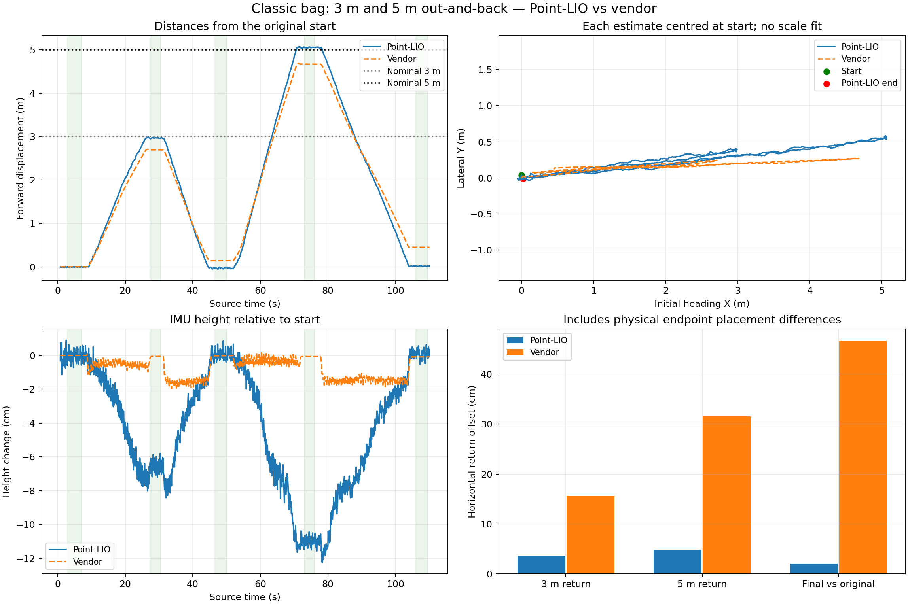

# Classic bag odometry comparison

Source: `/home/jain/go2_bags/classic/robot_20261018_055834_0.mcap`. Duration 110.157 s; 215,217 recorded messages.

Route supplied by the operator: 3 m forward, wait, 3 m back, wait; then 5 m forward, wait, 5 m back, wait.

| Check | Point-LIO | Vendor odometry |
|---|---:|---:|
| 3 m outbound horizontal displacement | 2.9913 m | 2.7046 m |
| 3 m inbound horizontal displacement | 3.0243 m | 2.5598 m |
| 3 m leg return offset | 3.53 cm | 15.59 cm |
| 5 m outbound horizontal displacement | 5.1153 m | 4.5321 m |
| 5 m inbound horizontal displacement | 5.0677 m | 4.2201 m |
| 5 m leg return offset | 4.76 cm | 31.50 cm |
| Final horizontal offset from original start | 1.97 cm | 46.69 cm |
| Final height change from original start | 0.07 cm | -0.09 cm |

## Integrity and replay

All 1,320 zstd chunks decompress; full container traversal and metadata message counts agree. The summary CRC is present and matches. Data chunks have no recorded CRC, so this is not a per-payload CRC guarantee. Every mapping input was deserialized; this check does not claim that every other topic uses a correct advertised schema.

Saved raw/body conversion checked against 14,285 matching points across 16 scans; maximum residual 2.757 micrometres. This confirms the recorded topic conversion, not an independent mount survey.

The source contains no Point-LIO output, so Point-LIO was recomputed using the existing binary, body IMU bias calibration, approved extrinsics and zero time-lag setting. A temporary startup override sets init_map_size=4000, as in the successful previous 3 m/5 m test. Application code/configuration hashes before and after agree: **True**.

Separate Humble-compatible SQLite replay was prepared because this bag has Jetson Jazzy metadata. Source MCAP was opened read-only and is SHA-256 identified in source.sha256. Isolated DDS domain 209, localhost only, 0.5x playback; only sensor/odometry/clock/TF topics published. No robot command topics replayed.

Cloud delivery matched all 1,698 source stamps exactly: **True**. Calibrated body IMU delivery matched all 31,978 output stamps exactly: **True**. Identical duplicate SportModeState samples dropped: 556; converter errors: 0.

Replay stop reason: `playback_complete`. 1,687 poses, mean 15.423 Hz. Pose timestamps nonincreasing: 0; nonfinite pose values: 0; translation steps >15 cm: 0; rotation steps >5 degrees: 0. Maximum single step 0.0390 m, 2.213 degrees.

Global TF parent conflicts: {}. Missing map->odom stamps: 1; extra stamps: 0. Exact full pose/TF stamp sequence match: False. Deferred TF lookup retries in logs can occur before the exact-time vendor transform arrives; they do not by themselves mean a pose was dropped.

## Timing

Raw clouds have no duplicate or backward header stamps and no gaps over three median scan periods; median period 64.888 ms. Body IMU has no backward stamps after duplicate filtering; 163 gaps exceed three median periods, maximum 32.180 ms. Source gaps are retained, not interpolated or hidden. Detailed nearby Point-LIO steps are in comparison.json.

1697 / 1698 scans lie within the IMU recording boundaries; only the first scan begins before the first IMU sample. Point-LIO starts at 0.776 s, after that boundary.

Recorder receipt minus robot header time includes an approximately 25.7 s clock offset. It must not be interpreted as 25.7 s network latency without independent clock synchronization. Source header times were preserved; no host/robot offset or acquisition-lag value was fitted to make the result look better. Zero acquisition lag is still uncalibrated. This replay does not establish exact LiDAR/IMU acquisition synchronization.

## Hold selection and floor consistency

Seconds below refer to the first raw-cloud header stamp. Medians use quiet interiors of the recorded waits, selected from vendor motion; there is no per-leg trajectory alignment or scale fit. Vendor positions are converted from base_link to the IMU using the developer URDF lever arm. Plot paths use one initial heading/translation for each estimate, preserving gravity axes.

- start: 3–7 s; Point-LIO position p95 radius 1.763 cm, body gyro RMS 0.0130 rad/s.
- far_3m: 27.5–30.5 s; Point-LIO position p95 radius 2.250 cm, body gyro RMS 0.0126 rad/s.
- return_3m: 46.5–50 s; Point-LIO position p95 radius 2.073 cm, body gyro RMS 0.0123 rad/s.
- far_5m: 73–76 s; Point-LIO position p95 radius 3.026 cm, body gyro RMS 0.0123 rad/s.
- return_5m: 106–109.5 s; Point-LIO position p95 radius 1.494 cm, body gyro RMS 0.0125 rad/s.

Repeated floor heights use the same map XY cells directly, with no ICP or levelling. Candidate floor: within 3 m of initial IMU, 0.15–0.9 m below it, 15 cm cells containing at least 5 points.
- return_3m: 578 common cells; median absolute difference 2.62 mm; p90 26.88 mm.
- return_5m: 573 common cells; median absolute difference 2.25 mm; p90 22.60 mm.

The only missing map->odom transform is the final output pose, 19.36 ms beyond the last derived vendor TF at the recording boundary. Every earlier pose matches the TF stamp sequence exactly; this does not affect any selected endpoint hold.

Point-LIO estimates the 3 m far hold 6.61 cm below its start and the 5 m far hold 11.01 cm below its own start, then returns close to the original height. This could include actual slope or gravity/map tilt; the bag alone cannot distinguish them. The small return-height residual and floor-repeat medians are not proof of absolute vertical accuracy. Quiet-hold position p95 radii are about 1.5–3.0 cm, so do not interpret the 1.97 cm final median offset as a precise 2 cm absolute accuracy guarantee.

## Measurement limits

- Reported 3 m and 5 m are nominal references; physical measurement method and uncertainty were not supplied.
- Curved walking paths: reported hold-to-hold horizontal displacement, not integrated travelled path length.
- No independent endpoint survey. Return offsets include real placement differences and estimator error; they are not pure drift measurements.
- Vendor odometry shares body IMU information and is not ground truth. Its poses include the developer body-to-IMU lever arm.
- Repeated floor-cell agreement measures internal consistency, not surveyed absolute vertical accuracy.
- Zero LiDAR/IMU acquisition-lag correction remains uncalibrated. Replay success does not prove exact sensor synchronization.

Detailed numbers: [comparison.json](analysis/comparison.json). Input audits: [input_audit.json](input_audit.json), [source_timing.json](source_timing.json). Replay completion/delivery: [result.json](result.json).
