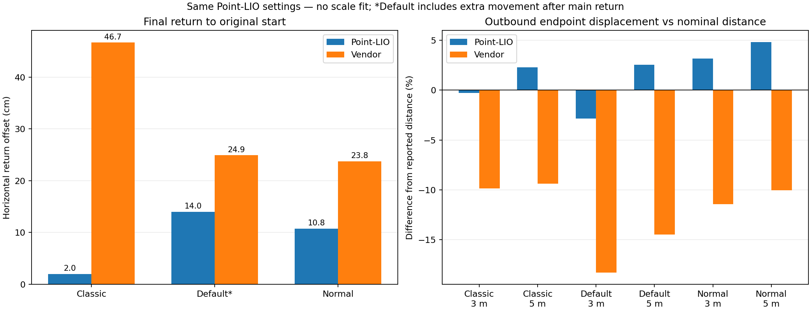

# Three recordings: Point-LIO vs vendor odometry

Operator confirmed the same nominal route for all recordings: 3 m forward/back, followed by 5 m forward/back, with waits. All Point-LIO runs use the same existing calibration, extrinsics, zero-lag setting and temporary 4,000-point startup seed. No application changes or per-bag tuning.

| Recording | 3 m forward PL / vendor | 3 m return PL / vendor | 5 m forward PL / vendor | 5 m return PL / vendor | Final return PL / vendor |
|---|---:|---:|---:|---:|---:|
| Classic | 2.99 / 2.70 m | 3.5 / 15.6 cm | 5.12 / 4.53 m | 4.8 / 31.5 cm | 2.0 / 46.7 cm |
| Default | 2.91 / 2.45 m | 7.1 / 9.9 cm | 5.13 / 4.28 m | 10.6 / 16.8 cm | 14.0 / 24.9 cm |
| Normal (nromal-np) | 3.10 / 2.66 m | 2.2 / 9.8 cm | 5.24 / 4.50 m | 11.0 / 15.7 cm | 10.8 / 23.8 cm |

PL = recomputed Point-LIO. Each 5 m leg is measured from its own preceding return hold; final return uses the original start. Endpoints use medians within independently selected quiet waits, not maximum travel or integrated speed.

## Replay quality

- Classic: 110.16 s, 1687 poses at 15.42 Hz; all replay cloud and calibrated IMU stamps match. Largest pose step 3.90 cm / 2.21 degrees. Nonfinite values 0, nonincreasing stamps 0, TF parent conflicts {}.
- Default: 88.43 s, 1353 poses at 15.42 Hz; all replay cloud and calibrated IMU stamps match. Largest pose step 4.54 cm / 2.93 degrees. Nonfinite values 0, nonincreasing stamps 0, TF parent conflicts {}.
- Normal (nromal-np): 83.64 s, 1279 poses at 15.42 Hz; all replay cloud and calibrated IMU stamps match. Largest pose step 4.74 cm / 2.50 degrees. Nonfinite values 0, nonincreasing stamps 0, TF parent conflicts {}.

All three source containers pass chunk decompression, count checks and summary CRC. Chunk payload CRCs are absent. All required mapping payloads were decoded; this does not guarantee every unrelated topic schema. All replays were headless, sequential, 0.5x, localhost-only, without command topics. Code/configuration hashes remained unchanged.

Per-run reports explain any final TF boundary mismatch. No endpoint measurement uses the very last output sample.

## Interpretation limits

- The 3 m / 5 m distances were supplied by the operator; measurement method and uncertainty are unknown. Curved-path endpoint displacement differs from travelled path length.
- Return offsets combine physical endpoint placement error and estimator error. Without surveyed positions, they are not pure drift measurements.
- These short out-and-back routes can cancel some systematic errors. They do not establish long-distance drift or loop closure performance.
- Vendor odometry is a comparison estimate and shares IMU information; it is not ground truth.
- Vertical return agreement does not establish correct absolute height. Reversible outward slopes may include real terrain or map/gravity tilt.
- Zero LiDAR/IMU acquisition-lag correction remains uncalibrated. Successful replay does not prove exact sensor synchronization.

Individual plots, timing audits, hold windows, source hashes and floor consistency:

- [Classic report](../classic_20261018/REPORT.md) · [plot](../classic_20261018/analysis/comparison.png)
- [Default report](../default_20261018/REPORT.md) · [plot](../default_20261018/analysis/comparison.png)
- [Normal (nromal-np) report](../nromal-np_20261018/REPORT.md) · [plot](../nromal-np_20261018/analysis/comparison.png)

Default includes a brief extra movement around 76–78 s after the main return. Before that movement, at 74.8–75.8 s, its estimated offset was Point-LIO 1.24 cm versus vendor 13.08 cm. The final quiet hold in the table is after that movement. Its 14 cm Point-LIO offset cannot all be called drift, and the final-offset bars alone must not be used to rank recording modes. The earlier stop is brief and less quiet.
