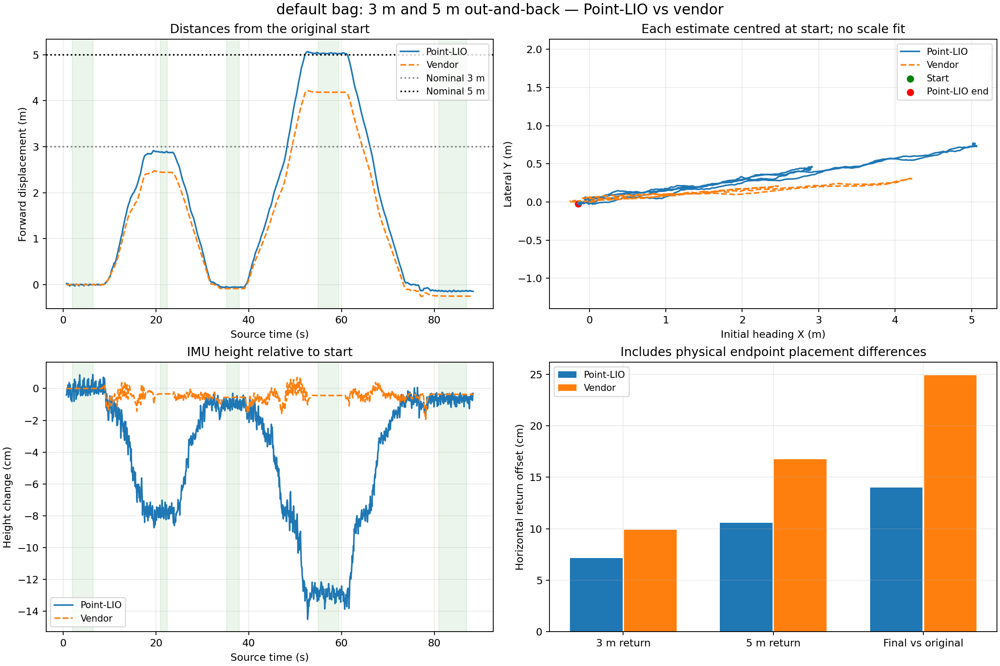

# default bag: Point-LIO and vendor odometry

Source: `/home/jain/go2_bags/default/robot_20261018_060104_0.mcap`. Duration **88.427 s**, 172,456 messages.

Operator confirmed the same route as classic: 3 m forward, wait, 3 m back, wait; then 5 m forward, wait, 5 m back, wait.

| Check | Point-LIO | Vendor odometry |
|---|---:|---:|
| 3 m outbound horizontal displacement | 2.9143 m | 2.4510 m |
| 3 m inbound horizontal displacement | 2.9617 m | 2.5324 m |
| 3 m leg return offset | 7.14 cm | 9.91 cm |
| 5 m outbound horizontal displacement | 5.1284 m | 4.2760 m |
| 5 m inbound horizontal displacement | 5.2209 m | 4.4416 m |
| 5 m leg return offset | 10.59 cm | 16.76 cm |
| Final offset from original start, horizontal | 14.01 cm | 24.93 cm |
| Final height change from original start | -0.64 cm | -0.37 cm |

## Recording integrity

All **1,052 zstd chunks decompress**. Full container traversal, MCAP statistics and metadata message counts agree. Summary CRC matches. No chunk payload CRCs are present, so this is not a per-payload CRC guarantee. All mapping inputs were deserialized. Unrelated message schemas were not fully validated.

Approved raw/body conversion agrees across 10,366 matched points in 13 scans, maximum residual 2.664 micrometres. This validates the recorded topic conversion, not a surveyed mount.

Source MCAP was read-only; source.sha256 identifies it. Original Jazzy metadata was preserved. Separate Humble-compatible SQLite replay includes only raw cloud, calibrated body IMU, vendor odometry and derived clock/TF. No robot command topics replayed.

## Recomputed Point-LIO

No Point-LIO output is present in the source. This replay uses the existing binary, unchanged bias calibration/extrinsics, zero acquisition-lag correction and the same temporary **init_map_size=4000** setting as classic. Headless, 0.5x playback, isolated localhost-only DDS domain 209. Application hashes unchanged: **True**.

Observer cloud delivery matched all 1,363 source stamps exactly: **True**. Calibrated IMU delivery matched all 25,681 stamps exactly: **True**. Duplicate SportModeState samples dropped: 443; converter errors: 0.

Stop reason `playback_complete`, player exit 0, launch exit 0. Point-LIO: **1,353 poses at 15.423 Hz**. Nonfinite pose values 0; nonincreasing stamps 0. Largest single translation step 4.54 cm, rotation 2.93 degrees. Steps >15 cm: 0; rotations >5 degrees: 0.

TF parent conflicts: {}. Missing pose TF stamps 0; extra stamps 0; exact full sequence match True. End-boundary check: `{"missing_pose_count": 0, "missing_only_at_end": false, "all_earlier_pose_tf_sequences_exact": true, "last_pose_beyond_last_derived_vendor_tf_ms": -31.682253}`. Deferred exact-time lookup retries are distinct from dropped outputs; selected endpoint holds precede the recording boundary.

## Timing and endpoint selection

Raw cloud median period 64.864 ms, no duplicate/backward stamps, no gaps exceeding three median periods. Calibrated IMU: 0 backwards stamps, 127 gaps exceeding three median periods, maximum 24.042 ms. Gaps are retained, not filled. Detailed largest gaps and nearby pose steps appear in comparison.json.

IMU recording brackets 1362 scans; 1 scans extend outside its boundaries. Point-LIO first output 0.710 s after first raw cloud header.

Recorder minus source-header time includes a host/robot clock offset; it is not direct network latency. Header times are unchanged. Zero acquisition lag remains uncalibrated; replay success does not establish exact LiDAR/IMU acquisition synchronization.

Endpoint holds were selected independently for this recording from its quiet waits. All times are seconds after the first raw-cloud header. Values are median positions; both estimates refer to the IMU using the developer body-to-IMU lever arm. No scale fit or per-leg pose alignment was used.

- start: 2–6.5 s, 70 poses; Point-LIO p95 distance to median 1.98 cm, body gyro RMS 0.0123 rad/s.
- far_3m: 21–22.5 s, 24 poses; Point-LIO p95 distance to median 1.35 cm, body gyro RMS 0.0123 rad/s.
- return_3m: 35.2–38 s, 44 poses; Point-LIO p95 distance to median 1.85 cm, body gyro RMS 0.0125 rad/s.
- far_5m: 55–59.5 s, 69 poses; Point-LIO p95 distance to median 2.15 cm, body gyro RMS 0.0126 rad/s.
- return_5m: 81–87 s, 92 poses; Point-LIO p95 distance to median 1.72 cm, body gyro RMS 0.0126 rad/s.

## Vertical consistency

- 3 m leg: Point-LIO far-hold height change -7.80 cm; returned height change -1.00 cm.
- 5 m leg: Point-LIO far-hold height change -11.91 cm; returned height change 0.36 cm.
- return_3m: 528 common 15 cm floor-candidate cells; median absolute difference 4.78 mm, p90 30.36 mm.
- return_5m: 573 common 15 cm floor-candidate cells; median absolute difference 4.72 mm, p90 28.15 mm.

Map XY grid 15 cm, >=5 points per cell, within 3 m of initial IMU and .15-.9 m below it; no ICP/relevelling. Same XY assumes adequate horizontal registration.

An outward height slope that reverses on return can include actual floor slope or gravity/map tilt. Return-height and repeated-cell agreement measure consistency, not absolute vertical accuracy.

## Limits

- Reported 3 m and 5 m are nominal references; physical measurement method and uncertainty were not supplied.
- Curved walking paths: reported hold-to-hold horizontal displacement, not integrated travelled path length.
- No independent endpoint survey. Return offsets include real placement differences and estimator error; they are not pure drift measurements.
- Vendor odometry shares body IMU information and is not ground truth. Its poses include the developer body-to-IMU lever arm.
- Repeated floor-cell agreement measures internal consistency, not surveyed absolute vertical accuracy.
- Zero LiDAR/IMU acquisition-lag correction remains uncalibrated. Replay success does not prove exact sensor synchronization.

Quiet-hold pose variation is included above. Small median return offsets must not be interpreted as an equally precise absolute accuracy guarantee.

Details: [comparison.json](analysis/comparison.json), [input_audit.json](input_audit.json), [source_timing.json](source_timing.json), [result.json](result.json).

## Extra movement after the main return

The default recording includes renewed SportModeState speed and gyro motion around 76–78 s, after a brief initial stop. At 74.8–75.8 s, the Point-LIO median was 1.24 cm from the original start, versus vendor 13.08 cm. Point-LIO estimates a subsequent 14.13 cm shift before the final quiet hold. The main table deliberately retains the final quiet hold; its 14 cm Point-LIO offset must not all be labelled drift. The earlier stop is brief and has more body sway. Details: [default_extra_movement.json](analysis/default_extra_movement.json).
