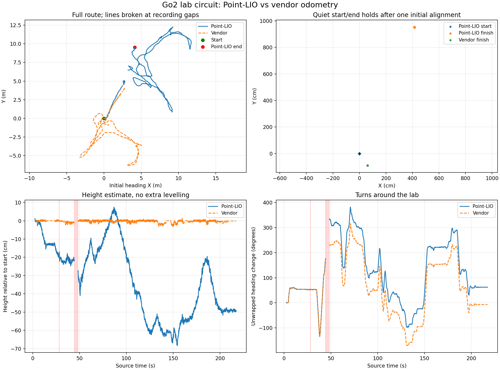

# Go2 lab circuit: return and drift screening

**Outcome: Point-LIO fails this lab return test.** The operator returned approximately to the start, but Point-LIO reports 10.39 m horizontal displacement, -0.49 m height change and 62.37 degrees heading change. Vendor return displacement is 1.08 m. This run must not be used as evidence of reliable longer-distance mapping.

The decisive orientation disagreement appears across the 44.38–48.33 s recording gap: approximately 5.3 degrees before it and 103.2 degrees after it. Point-LIO rotates 157.8 degrees across that interval; vendor rotates 52.8 degrees. The estimator continues publishing after losing agreement. Continuous ROS delivery during replay does not mean correct state estimation.

[Failure timeline plot](analysis/failure_timeline.png) · [Detailed event data](analysis/failure_timeline.json)

Source: `/home/jain/go2_bags/go2_20261018_173219`. Duration **217.353 seconds**, 410,412 messages. Operator drove around the lab and returned roughly to the original physical position and heading. No measured path length or endpoint survey supplied.

| Return check | Point-LIO | Vendor odometry |
|---|---:|---:|
| Horizontal offset from starting hold | 1038.77 cm | 108.31 cm |
| Signed height change | -49.00 cm | -0.12 cm |
| Heading change | 62.37 degrees | -7.11 degrees |
| Full orientation change | 62.45 degrees | 7.15 degrees |

These are differences between estimated start/end poses. They include actual placement/heading differences and estimator error, so they are not pure drift measurements.

## Input integrity and setup

SQLite `PRAGMA integrity_check`: **['ok']**. Full traversal and metadata counts match. All mapping inputs deserialize. The two 2.30 GB source copies are byte-for-byte identical (SHA-256 in source_hashes.json). Source files were read-only; no application code/configuration changes. Unrelated topic payload schemas were not exhaustively validated.

Saved LiDAR conversion matches 23,481 paired points across 33 scans; largest residual 5.95 micrometres. This checks topic geometry, not a surveyed mount.

The first second contains body motion. Diagnostic playback therefore excludes the first 1.5 seconds of receipt time and republishes the existing static sensor TF at its new start. All remaining source header stamps and recording gaps are unchanged. Point-LIO first output: 2.395 s relative to the original first raw-cloud header. Start hold: [2.6, 3.6] s; finish hold: [210.0, 216.0] s.

The estimator uses the same existing standalone Point-LIO binary, fixed body-IMU bias calibration, approved extrinsics, zero acquisition-lag correction and temporary init_map_size=4000 setting used for classic/default/normal. Vendor poses are converted from base_link to the IMU with the developer URDF lever arm. Paths are aligned only by initial yaw/translation for plotting; no scale fitting or per-section alignment.

## Recording gaps

- Raw LiDAR gap: 28.056–28.316 s, **0.260 s**.
- Raw LiDAR gap: 44.319–48.272 s, **3.953 s**.

The body IMU, vendor odometry and all-topic receipt stream also have corresponding gaps. Structural integrity does not mean continuous recording. The cause cannot be identified from this file alone; no sensor samples or unobserved motion were fabricated.

Point-LIO output changes across gaps:

- 28.119–28.378 s: position changes 0.103 m and orientation 3.85 degrees over 0.259 s. This combines real unobserved motion with possible estimation error; it is not automatically an instantaneous pose jump.
- 44.381–48.335 s: position changes 1.499 m and orientation 157.85 degrees over 3.953 s. This combines real unobserved motion with possible estimation error; it is not automatically an instantaneous pose jump.

## Delivery, continuity and TF

Replay finished: `playback_complete`. 3,254 Point-LIO poses, typical 15.41 Hz excluding source gaps. Input observer matched all **3,267 cloud** and **61,864 calibrated IMU** timestamps in the selected replay: cloud=True, IMU=True. The omitted initial messages are listed in stationary_start.json. Identical SportModeState duplicates filtered from the whole source: 890; converter errors: 0.

Nonfinite pose values 0; nonincreasing output stamps 0. Across contiguous outputs (<150 ms apart), largest translation step 13.29 cm and rotation 5.92 degrees. Steps over 15 cm: 0; rotations over 5 degrees: 19.

Global TF parent conflicts: {}. Exact full output/TF timestamp match: True. Missing TF pose stamps: 0; extra TF stamps: 0. Application source/configuration hashes unchanged: True. No commands replayed; offline DDS domain 209, localhost only, headless, 0.5x playback.

Quiet-hold position p95 radii:

- start: Point-LIO 3.45 cm; vendor 0.01 cm; 15 samples.
- finish: Point-LIO 2.16 cm; vendor 0.01 cm; 92 samples.

## Estimated travel and floor consistency

- point_lio: 64.24 m along smoothed observed segments, excluding gaps. Straight endpoint chord lengths across the gaps: [0.10277323725208332, 1.4991199509112805] m.
- vendor: 52.88 m along smoothed observed segments, excluding gaps. Straight endpoint chord lengths across the gaps: [0.09117507191532874, 0.8175401722251919] m.

Travel is derived from each estimate, not a surveyed distance. Calculation: 0.1 s grid and Gaussian sigma 0.2 s, separate contiguous segments. Turning/body motion, estimation noise and unobserved motion limit interpretation.

Same floor cells assume adequate horizontal overlap and measure internal map consistency, not absolute vertical accuracy.

## Additional source-cloud check

Raw clouds from the stationary start/end holds were transformed using fixed approved sensor extrinsics and matched with robust point-to-plane ICP. No odometry was supplied. Multiple initial guesses and independent interleaved frame subsets were tested.

Consistency gates passed: **False**. The fit is retained for review in [return_registration.json](return_registration.json).

The scan fit is **not used as a drift reference**. Agreement among starting guesses alone does not establish accurate registration. Its residual/sample-consistency checks are not all sufficient. No surveyed ground-truth accuracy is claimed.

## Limits

- Physical return position/heading only approximate, so median return offset is not pure estimator drift.
- Sensor recording contains an approximately four-second gap during motion and a shorter gap. Both are retained; no samples are fabricated.
- Path lengths come from the estimates, not a tape measure; unobserved motion during gaps is unknown.
- Point-LIO has no loop-closure correction in this run. Small endpoint error does not prove the trajectory is accurate everywhere.
- Vendor odometry is a comparison estimate sharing body IMU information, not ground truth.
- Zero acquisition-lag correction remains uncalibrated; replay success is not proof of exact LiDAR/IMU acquisition synchronization.
- Raw-cloud registration is a conditional static-scene geometric check, not independent surveyed truth.

Evidence: [comparison.json](analysis/comparison.json), [input_audit.json](input_audit.json), [source_timing.json](source_timing.json), [large_source_gaps.json](large_source_gaps.json), [stationary_start.json](stationary_start.json), [result.json](result.json).

## What this establishes and what to address next

The source has a substantial recording dropout while the dog is moving and turning. Point-LIO loses attitude agreement across that dropout and does not recover the correct route. This is evidence of failure to handle missing acquisition data in this replay, not proof that the current calibration succeeds on an uninterrupted long route. Before the gap, attitude disagreement was already several degrees and the height estimate had fallen around 22 cm; those remain separate concerns.

Code inspection of the existing output-model branch shows prediction over elapsed IMU timestamps without a large-gap reset/limit at third_party/point_lio_ros2/src/laserMapping.cpp around lines 1003–1005. The IMU callback rejects backwards stamps but has no equivalent forward-gap guard. This is consistent with propagation across an unobserved interval; no code changes were applied.

Next useful work is to identify why the recorder lost all topics for about 3.86 s, obtain a continuous stationary-start lab recording, and review a gap-detection policy that stops treating the estimator pose as valid through a severe dropout. Missing physical motion cannot be recovered by renaming frames, retimestamping or filling fabricated samples. Any implementation change still requires user confirmation.
