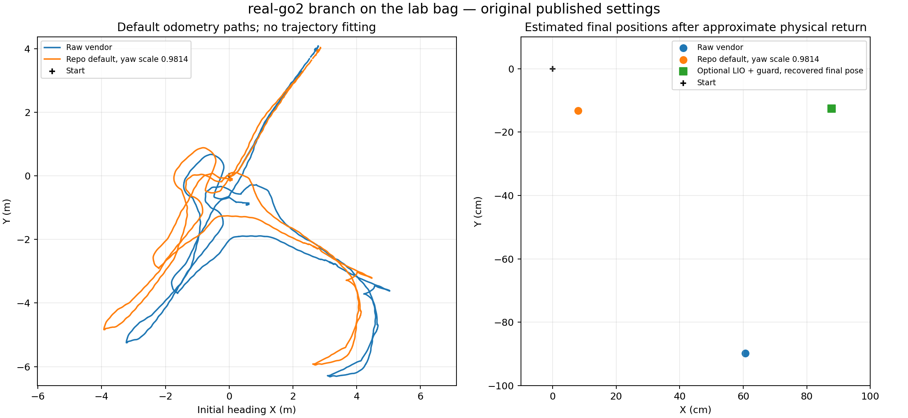

# real-go2 branch: odometry check on the lab bag

Repository branch **real-go2**, pinned commit `c3158fcef41532fc5dc754e5838b0dfdecb5506a`. Lab source: `/home/jain/go2_bags/go2_20261018_173219`, 217.353 s. Operator returned approximately to the starting position and heading.

| Path | Estimated horizontal return offset | Estimated heading change |
|---|---:|---:|
| Raw vendor | 1.083 m | -7.11 degrees |
| Repo default, yaw_scale=0.9814 | **0.155 m** | -6.98 degrees |
| Repo optional Point-LIO with guarded vendor bridge | 0.887 m | -6.00 degrees |

Return offsets include real placement differences and estimator error; no surveyed ground-truth drift is claimed. All endpoint comparisons use the same developer URDF IMU lever arm and quiet windows, 2.6–3.6 s and 210–216 s.

## Default path

[real_mapping.launch.py](https://github.com/Faheemibrahim/unitree_go2_ros2/blob/c3158fcef41532fc5dc754e5838b0dfdecb5506a/unitree_go2_real/launch/real_mapping.launch.py) defaults to lio=false. [real_bridge.yaml](https://github.com/Faheemibrahim/unitree_go2_ros2/blob/c3158fcef41532fc5dc754e5838b0dfdecb5506a/unitree_go2_real/config/real_bridge.yaml) supplies yaw_scale=0.9814. [real_tf_bridge.py](https://github.com/Faheemibrahim/unitree_go2_ros2/blob/c3158fcef41532fc5dc754e5838b0dfdecb5506a/unitree_go2_real/scripts/real_tf_bridge.py) rotates each vendor translation step into the body frame and reintegrates it using scaled heading increments. The value is the repository author's published setting; it was not fitted to this bag.

The original on_odom callback was run offline on all 31,905 source vendor messages with ROS side effects replaced by passive sinks. The identity setting yaw_scale=1.0 reproduces the original pose values to 5.91e-14 maximum absolute difference. Default correction improves this lab route's return from 1.083 m to 0.155 m.

## Optional Point-LIO path and guard

The original [LioInput adapter](https://github.com/Faheemibrahim/unitree_go2_ros2/blob/c3158fcef41532fc5dc754e5838b0dfdecb5506a/unitree_go2_real/scripts/lio_input.py), [Point-LIO profile](https://github.com/Faheemibrahim/unitree_go2_ros2/blob/c3158fcef41532fc5dc754e5838b0dfdecb5506a/unitree_go2_real/config/point_lio_go2.yaml) and point_lio_unilidar package were tested without source changes. The adapter uses vendor-deskewed clouds transformed back into body coordinates, LiDAR gyro with startup bias subtraction, zero accelerometer input, and accumulation configured as con_frame_num=8. The branch's accumulator publishes the accumulated group on a following callback; its native LIO update cadence is therefore slower than the high-rate vendor output.

The guarded bridge accepted **69** LIO corrections, last at **44.122 s**. After the four-second recording gap it rejected **290** corrections, first at **48.594 s**; no later LIO correction was accepted. Its thresholds are 0.3 m and 5 degrees against the previous correction. The first rejection in bridge.log is about 1.96 m / 104.7 degrees. Thus this optional Point-LIO also fails across the data gap. The bridge protects the published pose by holding its last accepted correction and continuing vendor odometry.

The optional output keeps vendor z, roll and pitch. Its returned height is not an independent LIO vertical-accuracy measurement. A protected hybrid output must not be interpreted as healthy raw Point-LIO after the gap.

## Recovery and verification limits

The original bridge finished processing the bag, but its separate observer was interrupted before saving pose arrays. Exact start/end output is recovered by calling original on_odom with saved accepted correction M (identity at start, constant final M during the finish hold). Every source vendor message in both endpoint windows was received by the bridge. No complete LIO/hybrid trajectory is claimed.

All 148 initial-hold and 897 final-hold source messages were verified present in the bridge's saved callback sequence. Correction M is identity throughout the initial hold and unchanged throughout the final hold, so rerunning the original on_odom callback recovers those endpoint outputs exactly. Full optional LIO/hybrid trajectory arrays were not saved and are not reconstructed or plotted. The plot shows full paths only for the default/raw modes, plus the recovered optional final endpoint.

The bridge audit reaches 217.170 s and contains 359 LIO correction events. It received 31901 / 31905 vendor messages. Missing source times: `[0.019450664, 0.027157545, 0.032807588, 48.281332016]` s, outside the selected endpoint holds. Full observer-based cloud/IMU delivery verification is unavailable for this interrupted optional observer; the earlier complete lab replay has its own delivery audit. Acquired source gaps were preserved, not filled.

Original source and active application/calibration hashes unchanged: **True**. Build and replay stayed in a separate review workspace / localhost-only DDS domain 210. No commands were replayed. Existing active TF and mapping setup were not changed.

## Straight-distance cross-check

The same original default yaw correction was also checked on the earlier recordings, using their existing quiet holds:

| Bag | Raw vendor 3 m / 5 m | Corrected vendor 3 m / 5 m |
|---|---:|---:|
| classic | 2.705 / 4.532 m | 2.705 / 4.532 m |
| default | 2.451 / 4.276 m | 2.451 / 4.276 m |
| nromal-np | 2.657 / 4.499 m | 2.657 / 4.499 m |

The heading correction improves the lab return but does not fix vendor distance-scale underestimation. A near-closed route can still have incorrect map scale. Same hardware does not establish that a correction calibrated on one day/gait/firmware applies generally.

## Practical result

The default corrected-vendor path is promising for planar odometry on this turning lab route, with separate scale validation needed. The optional guard is useful protection against divergent LIO updates, but the underlying estimator did not survive the four-second sensor dropout. An uninterrupted stationary-start lab recording is still needed to evaluate longer-distance LIO. No adoption or code changes have been applied.

Evidence: [default callback audit](results/default_bridge_comparison.json), [recovered guarded endpoints](results/recovered_optional_comparison.json), [guard audit](results/bridge_audit.json), [input adapter audit](results/input_adapter_audit.json), [bridge log](results/bridge.log).
